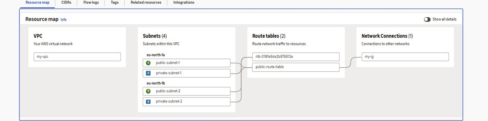
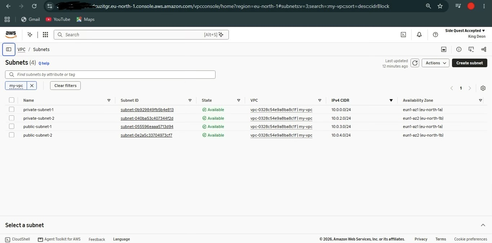
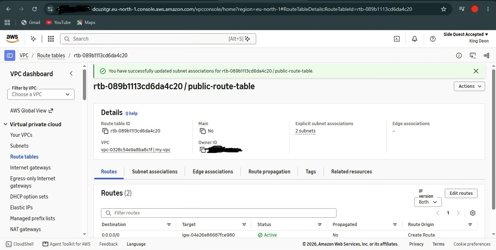

# AWS Module 5: Networking (VPC build)

AWS Cloud Practitioner Essentials: Module 5 (Networking) ✅

I'm only at the introduction level in networking on Hack The Box, so seeing how networking works in the cloud was a great way to connect the basics to something real.

## Networking in AWS Cloud

This consists of infrastructure and services working together to host your applications, data and any other resources you might need.

## What I built

This week I built a VPC by hand in the console:

- A VPC (10.0.0.0/16) in eu-north-1
- 4 subnets across 2 Availability Zones: 2 public, 2 private
- An internet gateway attached to the VPC
- A public route table sending 0.0.0.0/0 to the internet gateway, associated with the public subnets

## Screenshots

## What I learned

- A subnet isn't "public" because of its name. It's public because its route table has a route to an internet gateway. Private subnets don't have one.
- Spreading subnets across 2 Availability Zones means one failing doesn't take everything down.
- There are also ways to connect to AWS beyond the public internet, such as a VPN or AWS Direct Connect.

Next up: Module 6.
